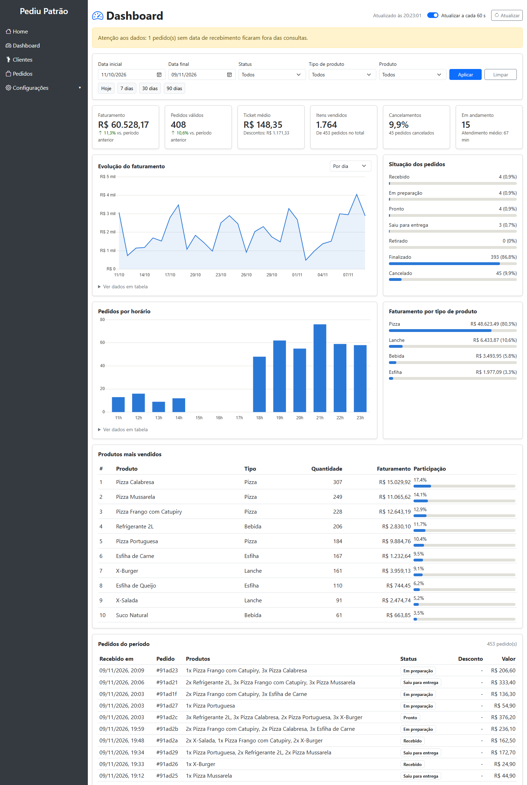
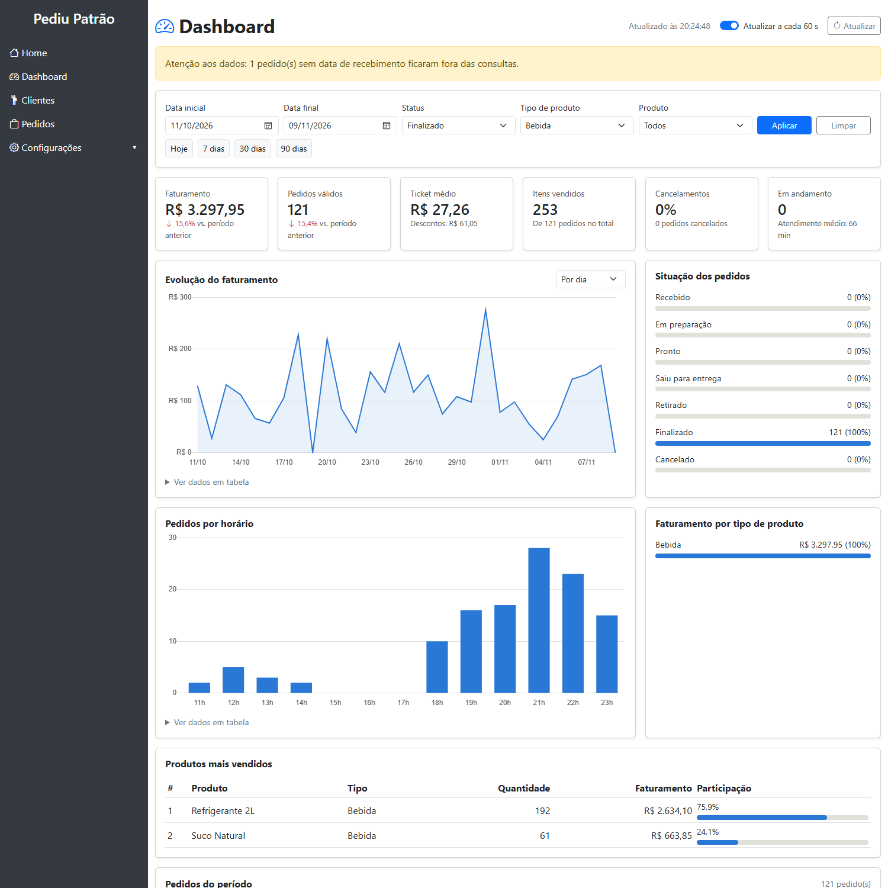
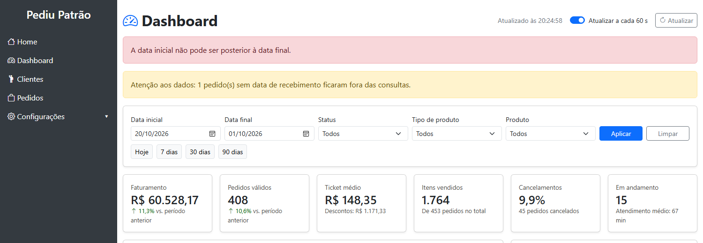
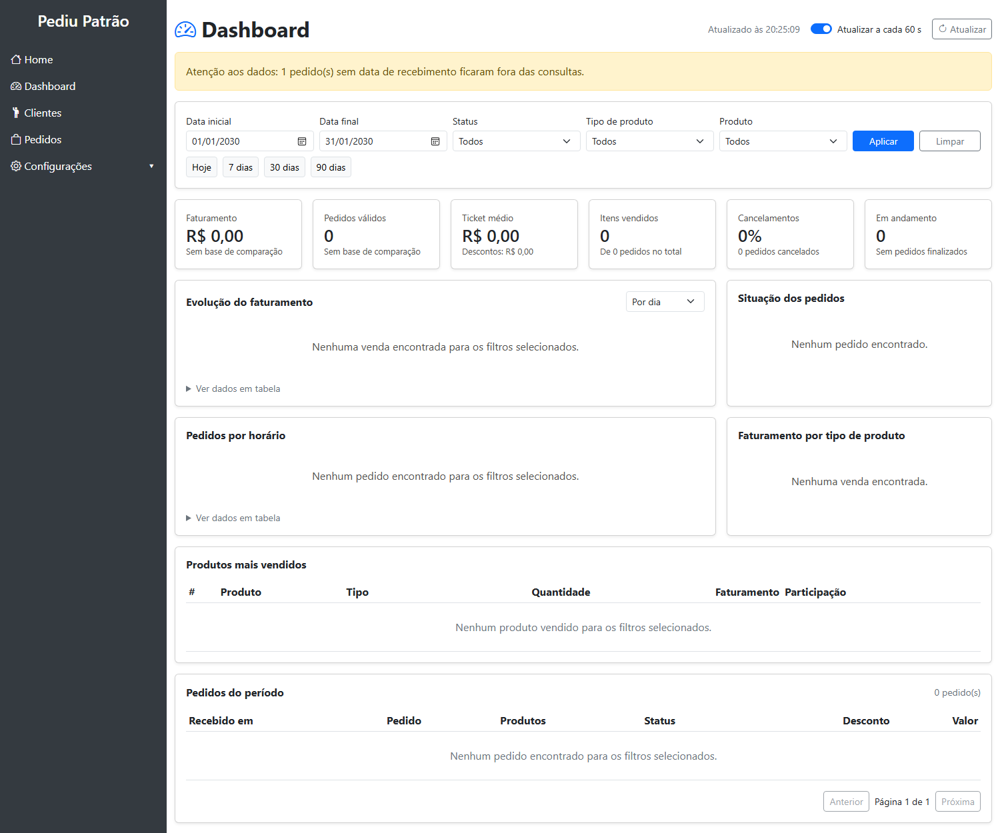
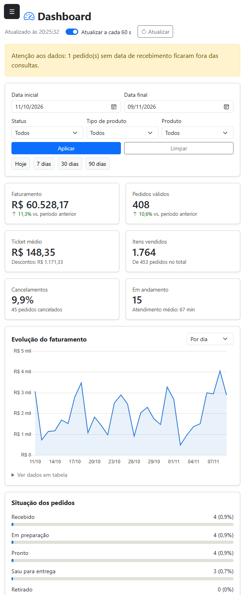

# Evidências de testes

Testes executados em 09/11/2026 sobre a branch `feature/api-dashboard`.

## Ambiente e método

- Windows 11, Java 21, MongoDB 9.0 e Microsoft Edge em modo automatizado.
- Banco MongoDB descartável, carregado com 1.521 pedidos de demonstração pelo perfil `carga-demo`. Para testar o tratamento de dados, foram incluídos 5 documentos antigos ou inconsistentes.
- API testada com chamadas HTTP reais, com perfis ADMIN, GERENTE e ATENDENTE.
- Tela testada no navegador com ações simuladas de filtro, paginação e atualização. Nesses testes, a autenticação foi enviada por HTTP Basic. O login pelo formulário foi testado separadamente, nos casos CT-05 e CT-06.

## Resumo

| Grupo | Executados | Aprovados |
|---|---|---|
| API | 29 | 29 |
| Tela | 12 | 12 |
| Testes automatizados já existentes no projeto | 7 | 7 |

**Não testado:** a exibição das dicas ao passar o mouse sobre os gráficos, porque o evento simulado não acionou o gráfico no navegador automatizado, e o layout em larguras abaixo de 500 px, que o navegador automatizado não alcança.

## Casos de teste da API

| ID | Requisito | Cenário | Requisição | Esperado | Obtido | Resultado |
|---|---|---|---|---|---|---|
| CT-01 | RF06 | Sem autenticação nas 8 rotas da API | `GET /api/dashboard/*` | HTTP 401 com JSON | 8 de 8 rotas responderam HTTP 401 | Aprovado |
| CT-02 | RF06 | Perfil ATENDENTE nas 8 rotas da API | `GET /api/dashboard/*` | HTTP 403 com JSON | 8 de 8 rotas responderam HTTP 403 | Aprovado |
| CT-03 | RF06 | Perfil ADMIN nas 8 rotas da API | `GET /api/dashboard/*` | HTTP 200 com JSON | 8 de 8 rotas responderam HTTP 200 | Aprovado |
| CT-04 | RF06 | Perfil GERENTE nas 8 rotas da API | `GET /api/dashboard/*` | HTTP 200 com JSON | 8 de 8 rotas responderam HTTP 200 | Aprovado |
| CT-05 | RF06 | Login pelo formulário como GERENTE e abertura do painel | `POST /login, GET /dashboard, GET /api/dashboard/resumo` | Tela e API respondem HTTP 200 na mesma sessão | tela HTTP 200, API HTTP 200 | Aprovado |
| CT-06 | RF06 | Login pelo formulário como ADMIN e abertura do painel | `POST /login, GET /dashboard, GET /api/dashboard/resumo` | Tela e API respondem HTTP 200 na mesma sessão | tela HTTP 200, API HTTP 200 | Aprovado |
| CT-07 | RF05 | Data inicial posterior à final | `GET /api/dashboard/resumo?dataInicio=2026-10-10&dataFim=2026-10-01` | HTTP 400 com mensagem clara | HTTP 400: A data inicial não pode ser posterior à data final. | Aprovado |
| CT-08 | RF05 | Data em formato inválido | `GET /api/dashboard/resumo?dataInicio=10/10/2026` | HTTP 400 com mensagem clara | HTTP 400: Valor inválido para o parâmetro 'dataInicio'. Datas devem usar o formato AAAA-MM-DD. | Aprovado |
| CT-09 | RF05 | Período acima de 366 dias | `GET /api/dashboard/resumo?dataInicio=2020-01-01&dataFim=2026-01-01` | HTTP 400 com mensagem clara | HTTP 400: O período consultado não pode ultrapassar 366 dias. | Aprovado |
| CT-10 | RF05 | Status inexistente | `GET /api/dashboard/resumo?status=XPTO` | HTTP 400 com mensagem clara | HTTP 400: Status inválido: 'XPTO'. Valores aceitos: RECEBIDO, EM_PREPARACAO, PRONTO, SAIU_PARA_ENTREGA, RETIRADO, FINALIZADO, CANCELADO. | Aprovado |
| CT-11 | RF02 | Agrupamento inexistente | `GET /api/dashboard/vendas?agrupamento=ANO` | HTTP 400 com mensagem clara | HTTP 400: Agrupamento inválido: 'ANO'. Valores aceitos: DIA, SEMANA, MES. | Aprovado |
| CT-12 | RF04 | Limite do ranking abaixo do mínimo | `GET /api/dashboard/produtos/mais-vendidos?limite=0` | HTTP 400 com mensagem clara | HTTP 400: O parâmetro 'limite' deve estar entre 1 e 50. | Aprovado |
| CT-13 | RF04 | Limite do ranking acima do máximo | `GET /api/dashboard/produtos/mais-vendidos?limite=51` | HTTP 400 com mensagem clara | HTTP 400: O parâmetro 'limite' deve estar entre 1 e 50. | Aprovado |
| CT-14 | RF04 | Limite do ranking não numérico | `GET /api/dashboard/produtos/mais-vendidos?limite=abc` | HTTP 400 com mensagem clara | HTTP 400: Valor inválido para o parâmetro 'limite'. | Aprovado |
| CT-15 | RF03 | Página negativa | `GET /api/dashboard/pedidos?pagina=-1` | HTTP 400 com mensagem clara | HTTP 400: O parâmetro 'pagina' não pode ser negativo. | Aprovado |
| CT-16 | RF03 | Tamanho de página acima do máximo | `GET /api/dashboard/pedidos?tamanho=101` | HTTP 400 com mensagem clara | HTTP 400: O parâmetro 'tamanho' deve estar entre 1 e 100. | Aprovado |
| CT-17 | RF01, RF02, RF03, RF04, RF05 | Totais fecham entre as rotas: Sem filtro adicional | `Lista paginada comparada com resumo, séries, horário, status, ranking e tipos` | 12 conferências iguais | 12 de 12 conferências iguais (823 pedidos) | Aprovado |
| CT-18 | RF01, RF02, RF03, RF04, RF05 | Totais fecham entre as rotas: Status FINALIZADO | `Lista paginada comparada com resumo, séries, horário, status, ranking e tipos` | 12 conferências iguais | 12 de 12 conferências iguais (740 pedidos) | Aprovado |
| CT-19 | RF01, RF02, RF03, RF04, RF05 | Totais fecham entre as rotas: Status antigo ENTREGUE convertido em FINALIZADO | `Lista paginada comparada com resumo, séries, horário, status, ranking e tipos` | 12 conferências iguais | 12 de 12 conferências iguais (740 pedidos) | Aprovado |
| CT-20 | RF01, RF02, RF03, RF04, RF05 | Totais fecham entre as rotas: Tipo de produto Pizza | `Lista paginada comparada com resumo, séries, horário, status, ranking e tipos` | 12 conferências iguais | 12 de 12 conferências iguais (658 pedidos) | Aprovado |
| CT-21 | RF01, RF02, RF03, RF04, RF05 | Totais fecham entre as rotas: Produto específico | `Lista paginada comparada com resumo, séries, horário, status, ranking e tipos` | 12 conferências iguais | 12 de 12 conferências iguais (248 pedidos) | Aprovado |
| CT-22 | RF04 | Filtro por produto limita o ranking | `GET /api/dashboard/produtos/mais-vendidos?produtoId=...` | Somente o produto filtrado | 1 produto: Refrigerante 2L | Aprovado |
| CT-23 | RF07 | Período sem pedidos | `GET /api/dashboard/resumo?dataInicio=2030-01-01&dataFim=2030-01-31` | HTTP 200 zerado e sem variação | HTTP 200, faturamento 0.0, pedidos 0, variação None | Aprovado |
| CT-24 | RF03 | Página além do fim | `GET /api/dashboard/pedidos?pagina=9999` | HTTP 200 com lista vazia | HTTP 200, 0 itens | Aprovado |
| CT-25 | RF07 | Dados antigos e inconsistentes no resumo | `5 documentos preparados no banco; GET /api/dashboard/resumo?dataInicio=2025-03-10&dataFim=2025-03-10` | 4 pedidos, 3 válidos, faturamento 50.00, 1 status indefinido, 1 sem valor, 1 sem data | 4 pedidos, 3 válidos, faturamento 50.0, 1 indefinido, 1 sem valor, 1 sem data | Aprovado |
| CT-26 | RF07 | Status antigos convertidos | `GET /api/dashboard/pedidos/status?dataInicio=2025-03-10&dataFim=2025-03-10` | ENTREGUE vira FINALIZADO, PENDENTE vira RECEBIDO, XPTO vira INDEFINIDO | FINALIZADO 2, RECEBIDO 1, INDEFINIDO 1 | Aprovado |
| CT-27 | RF06 | Rota anterior do sistema preservada | `GET /api/pedidos com perfil ATENDENTE` | HTTP 200 | HTTP 200 | Aprovado |
| CT-28 | RNF02 | Tempo de resposta do resumo em 366 dias | `15 chamadas a GET /api/dashboard/resumo com cerca de 1.500 pedidos` | Mediana abaixo de 2.000 ms | mediana 987 ms, máximo 1544 ms | Aprovado |
| CT-29 | RF07 | Banco de dados indisponível | `MongoDB encerrado; GET /api/dashboard/resumo com sessão válida` | HTTP 503 com mensagem amigável | HTTP 503: Não foi possível consultar os dados no momento. Tente novamente em instantes. | Aprovado |

Em CT-28, cada chamada inclui a verificação da senha por HTTP Basic. A mediana em 30 dias foi de 777 ms.

## Casos de teste da tela

| ID | Requisito | Cenário | Obtido | Resultado |
|---|---|---|---|---|
| TL-01 | RF01, RF02, RF03, RF04 | Abertura do painel com o período padrão | 6 indicadores, 2 gráficos, status, ranking e lista carregados, sem erros de JavaScript | Aprovado |
| TL-02 | RF05 | Filtro por tipo Bebida e status Finalizado | 121 pedidos, com 100% do faturamento em Bebida | Aprovado |
| TL-03 | RF07 | Datas invertidas | Mensagem de erro exibida e dados anteriores mantidos | Aprovado |
| TL-04 | RF07 | Período sem pedidos | Indicadores zerados e mensagens de ausência de dados | Aprovado |
| TL-05 | RF03 | Próxima página da lista | Página 2 de 46 | Aprovado |
| TL-06 | RF02 | Agrupamento por mês | Tabela do gráfico com 2 períodos | Aprovado |
| TL-07 | RF05 | Atalho de 7 dias | Período de 03/11 a 09/11, com 118 pedidos | Aprovado |
| TL-08 | RF05 | Botão Limpar | Filtros e período padrão restaurados, com 453 pedidos | Aprovado |
| TL-09 | RF07 | Atualização automática | 2 consultas ao resumo após 66 segundos de tempo simulado | Aprovado |
| TL-10 | RF07 | Sessão expirada | Redirecionamento para a tela de login | Aprovado |
| TL-11 | RF06 | Acesso do perfil ATENDENTE | HTTP 403 em `/dashboard` e menu sem o link, presente para ADMIN | Aprovado |
| TL-12 | RNF04 | Tela com 620 px de largura | Componentes reorganizados, sem cortes | Aprovado |

## Capturas de tela

O aviso amarelo nas capturas vem de um documento sem data incluído de propósito na base de teste.

### Painel completo

### Filtros aplicados

### Erro de validação

### Período sem dados

### Tela estreita

