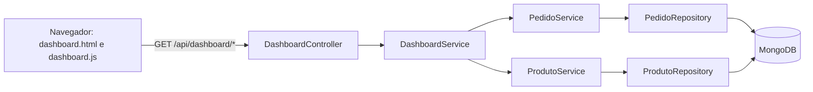

# Dashboard Administrativo: requisitos e decisões de projeto

## 1. Contexto e objetivo

O Pediu Patrão é um sistema de pedidos para lanchonete e pizzaria. O Dashboard Administrativo permite que o responsável pelo estabelecimento acompanhe o desempenho das vendas, consulte os pedidos e identifique tendências da operação, a partir de dados entregues por uma API própria.

## 2. Atores

| Ator | Perfil no sistema | Acesso ao dashboard |
|---|---|---|
| Responsável pelo estabelecimento | GERENTE | Tela e API |
| Administrador do sistema | ADMIN | Tela e API |
| Atendente | ATENDENTE | Sem acesso |

## 3. Requisitos funcionais

### RF01: Indicadores gerais de vendas

O painel apresenta, para o período e os filtros selecionados:

- faturamento e quantidade de pedidos válidos, com a variação em relação ao período anterior de mesma duração;
- ticket médio e total de descontos concedidos;
- itens vendidos e total de pedidos;
- taxa e quantidade de cancelamentos;
- pedidos em andamento e tempo médio de atendimento.

Rotas: `GET /api/dashboard/resumo` e `GET /api/dashboard/pedidos/status`.

### RF02: Análise de vendas (gráficos)

O painel apresenta a evolução do faturamento por dia, semana ou mês, os pedidos por horário e o faturamento por tipo de produto. Os dois gráficos principais têm uma visão alternativa em tabela.

Rotas: `GET /api/dashboard/vendas`, `GET /api/dashboard/vendas/por-horario` e `GET /api/dashboard/vendas/por-tipo`.

### RF03: Situação dos pedidos

O painel apresenta a quantidade e o percentual de pedidos em cada status e uma lista paginada, do mais recente para o mais antigo, com data, produtos, status, desconto e valor.

Rotas: `GET /api/dashboard/pedidos/status` e `GET /api/dashboard/pedidos`.

### RF04: Produtos mais vendidos

O painel apresenta o ranking dos 10 produtos mais vendidos, com quantidade, faturamento e participação. A API aceita de 1 a 50 posições.

Rota: `GET /api/dashboard/produtos/mais-vendidos`.

### RF05: Filtros de consulta

Todos os indicadores, gráficos, rankings e listas respondem aos mesmos filtros: data inicial, data final, status, tipo de produto e produto. O painel oferece atalhos para hoje e para os últimos 7, 30 e 90 dias. As opções disponíveis vêm de `GET /api/dashboard/filtros`.

### RF06: Integração com a API

O painel não calcula valores de negócio no navegador. Todos os dados vêm dos endpoints de `/api/dashboard`, que consultam o MongoDB. O acesso exige autenticação e perfil autorizado.

### RF07: Atualização e tratamento de dados

- A tela é atualizada a cada 60 segundos, de forma automática e desativável, ou pelo botão "Atualizar", e mostra o horário da última atualização.
- Status de versões anteriores são convertidos: `PENDENTE` em `RECEBIDO`, `EM_PREPARO` em `EM_PREPARACAO` e `ENTREGUE` em `FINALIZADO`.
- Pedidos no formato antigo, sem lista de itens, são tratados como pedidos de um item.
- Pedidos sem data, com status desconhecido ou sem valor são contabilizados e informados em um aviso na tela.
- Períodos sem dados exibem mensagens próprias, e erros da API aparecem na tela sem apagar os dados já exibidos.

## 4. Requisitos não funcionais

| ID | Categoria | Requisito |
|---|---|---|
| RNF01 | Segurança | A autorização é aplicada no servidor, na rota e na camada de serviço. A API não expõe nome ou contato de clientes. |
| RNF02 | Desempenho | A rota de resumo deve responder com mediana abaixo de 2 segundos em um período de 366 dias e cerca de 1.500 pedidos, em ambiente local. O campo de data dos pedidos é indexado. |
| RNF03 | Confiabilidade | Erros seguem um formato JSON único, sem expor detalhes internos. A indisponibilidade do banco retorna HTTP 503. |
| RNF04 | Usabilidade | A tela usa o layout existente do sistema e se adapta a telas estreitas. Os valores seguem o padrão brasileiro de moeda, número e data. |
| RNF05 | Exatidão | Valores monetários usam `BigDecimal` com duas casas. Os agrupamentos por data usam o fuso `America/Sao_Paulo`. |
| RNF06 | Compatibilidade | O dashboard não altera o comportamento das rotas anteriores nem exige novas coleções. Requer Java 21 e MongoDB. |
| RNF07 | Manutenibilidade | O código segue a divisão existente em controller, service e repository, e reaproveita as regras de `PedidoService`. |

## 5. Regras de negócio

| ID | Regra |
|---|---|
| RN01 | Pedido válido é o pedido que não está cancelado nem com status desconhecido. |
| RN02 | Faturamento é a soma dos pedidos válidos, já com desconto. |
| RN03 | Ticket médio é o faturamento dividido pela quantidade de pedidos válidos. |
| RN04 | Taxa de cancelamento é a quantidade de pedidos cancelados dividida pelo total de pedidos consultados. |
| RN05 | Sem datas informadas, a consulta usa os últimos 30 dias, incluindo o dia atual. O período máximo é de 366 dias. |
| RN06 | O período de comparação tem a mesma duração e termina no dia anterior ao início da consulta. |
| RN07 | Com filtro de produto ou tipo, são considerados apenas os itens correspondentes, com o desconto do pedido aplicado proporcionalmente. |
| RN08 | Em andamento são os pedidos com status `RECEBIDO`, `EM_PREPARACAO`, `PRONTO`, `SAIU_PARA_ENTREGA` ou `RETIRADO`. |
| RN09 | Tempo médio de atendimento é a média, em minutos, entre o recebimento e a finalização. |
| RN10 | O ranking é ordenado por quantidade e, em caso de empate, por faturamento. |

## 6. Dados utilizados

O dashboard consulta a coleção `pedidos`, já existente, e a coleção `produtos`, usada para montar os filtros.

| Campo em `pedidos` | Uso |
|---|---|
| `recebidoEm` | Filtro de período, agrupamentos por data e horário |
| `finalizadoEm` | Tempo médio de atendimento |
| `status` | Situação dos pedidos e pedidos válidos |
| `itens` (`produtoId`, `produtoNome`, `tipoProduto`, `quantidade`, `precoUnitario`, `subtotal`) | Ranking, tipos e filtros de produto |
| `percentualDesconto`, `valorDesconto`, `valorTotal` | Faturamento e descontos |
| `produtoId`, `produtoNome`, `tipoPizza`, `quantidade`, `precoUnitario` | Compatibilidade com pedidos antigos |

## 7. Arquitetura

## 8. Principais decisões de projeto

| Decisão | Justificativa |
|---|---|
| Usar a coleção `pedidos` sem criar tabelas de resumo | Os pedidos já têm os dados necessários, e calcular na consulta evita manter cópias que podem ficar desatualizadas. |
| Filtrar o período no MongoDB e calcular no Java | O Spring Data grava `BigDecimal` como texto no MongoDB, formato que o banco não consegue somar. O Java mantém a exatidão e reaproveita as regras de pedidos antigos. |
| Reaproveitar `PedidoService` | A conversão de status e de pedidos antigos permanece em um único lugar. |
| Restringir o acesso a ADMIN e GERENTE | Segue a regra já usada pela auditoria, reservada a perfis de gestão. |
| Não exibir o nome do cliente | O perfil ADMIN não tem acesso a clientes no sistema, e a análise de vendas não depende desse dado. |
| Comparar com o período anterior | Mostra se a operação melhorou, em vez de exibir apenas números isolados. |
| Usar o fuso de São Paulo | O banco guarda horários em UTC. Sem a conversão, um pedido feito às 22h seria contado no dia seguinte. |
| Usar o Chart.js já presente no projeto | Atende aos gráficos sem acrescentar dependências. |
| Escrever os erros da API em JSON | O painel e outros clientes tratam todas as falhas da mesma forma. |
